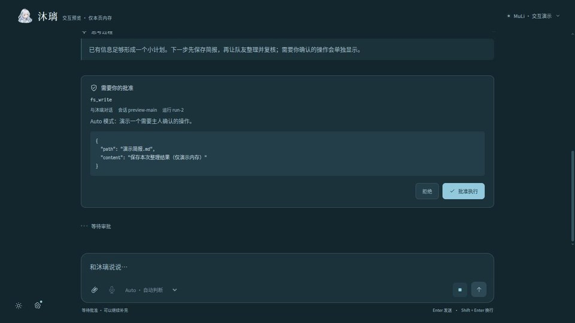

<div align="center">

# 沐璃 · MuLi

本地数字生命，与你一起把事情做好。

[](https://github.com/69gg/MuLi/actions/workflows/ci.yml)
[](https://www.python.org/)
[](LICENSE)

</div>

MuLi 是面向个人电脑的常驻助手：聊天、管理文件、搜索资料、记忆偏好、接收任务，以及让多个 agent 分工和复核。主要适配 Arch Linux 和其他 Linux；网页与核心服务支持 macOS / Windows，桌面操作和用户服务的能力按平台显示。

角色形象是十八岁的少女，定位为数字生命与本地助手，不设定恋爱关系。青瓷蓝工作台将对话放在中心，审批和设置按需展开。



## 能力

| 领域 | 当前实现 |
| --- | --- |
| 模型 | OpenAI Chat Completions、Responses、Anthropic 原生协议；流式/非流式、推理参数、工具回放、重试预算 |
| 协作 | 持续主身份、动态 spawn/send/wait/resume/stop 团队、显式附件交接与补充、可跨重启的增量结果游标、依赖工作流；历史成员无固定上限，执行有资源预算 |
| 权限 | ask 每个工具调用询问；auto 独立审查 agent，风险操作交给用户；yolo 自动执行 |
| 文件 | 目录、读取、写入、精确编辑、搜索、复制、移动、可恢复回收站；附件元数据检索与有界分页 |
| 搜索 | SearXNG / Brave / Tavily 可配服务，有限大小网页读取与来源链接 |
| 记忆 | 分层原文与后台提炼、关键词/embedding/关系图混合检索、reranker、多来源别名与实际召回路径、相关资料与侧写共同注入、原文分页核查、冲突修订、来源级忘记 |
| 电脑 | Linux AT-SPI 应用/窗口定位与节点操作；实验性 macOS AX 前台应用及原生引用；Windows UIA 顶层窗口/选定树、普通按钮一次 Invoke（Windows CI 自有按钮验收已通过，真实用户桌面未验）；可选有界截图、录屏与统一附件引用 |
| 渠道 | 可选 OneBot/NapCat、Telegram、QQ 官方机器人和微信 iLink；同一主身份、Team / Workflow 后台报告保留原渠道、失效目的地持久阻塞与本地文件收发 |
| 语音 | 独立默认关闭的网页录音转写草稿、本地中文声学唤醒与声纹桥接、录音参考、OpenAI 兼容 ASR/TTS、完整转写留存与续读；不附带本地模型 |
| 主动事件 | chiliarch 原生配对与 SSE 任务、默认关闭的普通消息资料提醒；Linux 指定目录的内核资料到达事件；持久提醒、维护结果与新版通知进入主会话，独立事项可按默认或显式记忆绑定通知，可选 Linux 桌面通知，无 AI 轮询 |
| 扩展 | Agent Skills 渐进读取与文档热发布、运行期间换代的可选 MCP 工具、按需文本资源与搜索结果链接原文读取、显式资源及工具图片附件保存与文本模板、用户目录 Python 插件；工具、提示词、模型、路由和生命周期可扩展 |
| 长任务 | 完整标题目录与已保存正文分页续读、后台分层压缩、协议回放、持久收件队列、完整任务说明、明确暂停与补充要求后的重新规划 |
| 管理 | 模型、权限、工具、目录、记忆、工作流、通知、服务状态与日志统一入口；`self_logs` 读取自身日志，`self_events` 分页回查保留错误，`self_failure` 按运行定位故障；活动工作流独立分页与逐次停止 |

已发行的 v2.44 为自动记忆提示增加[冲突证据组合](docs/memory.md#自动提示中的冲突组合开发中)：预算允许时一起提供有限双方，放不下则保留待核查提示，不只交付某一方正文。它复用已有来源、冲突和修订，不自动选择赢家；发行闭合、离线定向结果和未验边界见[审查记录](docs/review-v2.44.md#发版闭合)，不代表自然模型判断质量已验收。

## 启动

已发行的 v2.55 支持“让截图队友把 MCP 返回的图片交给沐璃看”：队友显式保存后用原附件交接，主助手再调用视觉工具；主模型可看图时使用主模型，否则使用已配置的外挂视觉模型。两种配置均已通过实际图像字节和摘要核对，远端发行和两包核对已闭合，见[MCP图片用法](docs/mcp.md#工具直接返回的图片v255)及[发行记录](docs/review-v2.55.md#发行闭合)。

已发行的 v2.56 支持“把这次看图的解释存下来，以后直接查”：显式存档提问、完整说明、实际模型与原图版本；压缩或正常重开后沿附件检索和分页回查，无需再次看图。真实离线旅程已验证私聊7存档、压缩重开后由当前私聊8完整回查并只向8回复，Web同时可见；解释仍是历史模型判断，不成为主人事实或授权。本地及远端验证、发行和两包元数据核对已闭合，见[视觉存档](docs/vision-archive-proposal.md)与[审查记录](docs/review-v2.56.md#发行闭合)。

需要 Python 3.12+ 和 [uv](https://docs.astral.sh/uv/)。前端无需安装 Node 依赖或构建。默认运行不依赖 Docker、向量数据库或本地模型。

```bash
uv tool install muli-agent
MuLi init
```

发行名称是 `muli-agent`，命令为 `MuLi` 或 `muli`。`init` 会询问称呼、主模型完整参数、视觉能力、监听地址和密码，然后安装当前用户的后台服务、启用登录启动并请求启动。可用 `--no-service` 跳过；`--defaults` 只创建默认配置。服务不可用时保留配置并给出 `MuLi serve` 前台启动方式。工作台默认 **http://127.0.0.1:8765**，沐璃会逐步协助配置其它能力。工作、独立审查、压缩和记忆提炼模型未单独配置时复用主模型；审查仍使用独立的无工具上下文。API key 可从环境变量读取。

默认所有内容集中在 `~/MuLi`：`config.json`、`data/`、`plugins/`、`prompts/`、`logs/` 和可选只读源码参考 `source/`。`MULI_HOME` 设置根目录，`MULI_CONFIG` / `MULI_DATA_DIR` 或 CLI `--config` / `--data-dir` 可单独覆盖。初始化不覆盖已有配置；旧路径不会被自动搬走。密钥不出现在配置读取 API；配置文件和数据库使用私人文件权限。

```bash
MuLi --config /path/config.json --data-dir /path/data serve --port 8766
MuLi doctor
```

模型连接尚未配置时，界面可用于管理，不会伪装产生模型回答。独立审查没有可用模型或调用失败时，auto 转为人工审批。最大输出 Token 默认留空，不向 OpenAI 协议发送此参数；Anthropic Messages 需显式填写。嵌入与重排序是单独的可选服务，在“媒体与检索”配置，用于长期记忆的向量召回和结果重排，不继承聊天模型。

v2.64 提供 `web/preview.html` 纯前端演示入口，无需真实后端即可体验流式对话、工具审批与完整管理页面；数据只在本页内存中保留，详见[前端预览](docs/frontend.md#纯前端交互预览)。

正文、思考和工具按事件次序放在同一中央列。思考与正文同宽，限高后在内部滚动；工具默认收起，展开可查看参数和结果，完成时原位更新并保留展开与焦点。前端回归、深浅主题浏览器检查和 v2.64 正式发行已通过，详见[验证记录](docs/frontend.md#验证)。

QQ 官方机器人和微信 iLink 使用可选加密依赖：`uv tool install 'muli-agent[channels]'`；同时需要 MCP 时使用 `uv tool install 'muli-agent[mcp,channels]'`。默认安装不包含本地语音或 GPU 模型；平台接入方式见[渠道说明](docs/channels.md)。

没有发令会话的主动通知默认留 WebUI，可在“消息渠道 → 主动通知”一次设置外部默认。启动自主更新检查、扩展目录自主 watch 的新失败状态、MCP 当前 HTTP/SSE 连接首次接收失败可使用该默认；主会话当前请求失败和新任务提醒保存原请求来源，旧记录及其它日志留本地。MCP 故障不自动重连或重放；默认更改只影响新事项，撤销后的待发项 blocked，unknown 不自动重试。见[默认通知的配置与边界](docs/channels.md#无发令会话时的默认通知)。

目标复盘支持对已有目标说：“周末提醒我复盘这个错题目标，看看已有依据、未验事项和下一步。”启用 Attention 并订阅 reminder 后，到期只读最新任务要求与交付验收单，沿创建约定的原私聊回复，Web 同时可见；不自动执行任务或发送文件。对应 v2.49 已完成正式发行与两处资产元数据核对，未联调真实账号；使用方法见[目标复盘](docs/attention.md#约定复盘指定任务)，验证范围见[审查记录](docs/review-v2.49.md#发行闭合)。

已发行的 v2.57 增加独立的定时委托：“明早开始搜索这个主题，以后每周整理，经队友执行和独立评审后把文字成果发回这里。”它保存原私聊/Web 来源和当前权限上限，与普通提醒的只读复盘分开；通过取消委托撤销，不借用选中任务的授权或暂停状态。ask/auto 审批、重开不重做及 unknown 不重发规则仍保留，进程停机不会被唤醒。候选和发行、两包核对已闭合，真实平台与自然模型效果未验；见[用法与边界](docs/attention.md#定时执行一份明确委托v257)及[实施状态](docs/scheduled-delegation-proposal.md)。

v2.58 已支持在主对话和通知页的“待批准”处理所有队友当前真正等待的工具审批，无需逐个打开记录。另一设备处理、停止或正常重开后，旧审批不能再次授权；见[合同与验证范围](docs/approval-inbox-proposal.md)。

v2.59 已发行，将同一入口接入已绑定的Telegram、OneBot私聊：发送 `/审批` 查看，复制完整ID后 `/批准 ID` 或 `/拒绝 ID`。决定不会成为新的模型输入，成果仍回原任务渠道；[使用方法与边界](docs/channels.md#手机上的工具审批)，[发行证据](docs/review-v2.59.md#发行闭合)。

v2.60 已发行，支持本地声纹请求的自动语音回答，默认关闭。完成现有唤醒、声纹和ASR/TTS配置后可开启；切换到网页、停止或关闭语音会撤销旧播放。见[语音配置](docs/voice.md)及[验证与发行范围](docs/review-v2.60.md#发行闭合)。

v2.61 已发行，让任务背景随真实队友继续：通用输入没有相关召回时，从冻结任务目标补充已有本地资料，保留当前查询、侧写、正文和原预算。见[任务记忆合同与发行证据](docs/task-memory-continuity.md#发行闭合)。

v2.63 已发行，支持主助手等候审批时直接续办你的新要求：在另一手机说“先别发送，改为解释”，旧主审批自动取消、原动作记为未执行，同一主运行继续回复当前输入。队友的独立审批保持原状；已开始的操作与流式回答继续收口。见[插话续办与验证范围](docs/owner-approval-steering.md)。

v2.64 已发行，让队友报告进入长期记忆：主助手直接队友的真实完成报告可保存为
独立资料，保留历史来源供以后检索与原文核查；沿原后台提炼、资源预算和来源级遗忘。
报告不成为主人偏好或授权，正常完成也不代表任务已经验收。正式测试和实施进度见
[队友报告记忆](docs/team-report-memory-proposal.md)，精确提交的候选与发行 CI、签名标签及 GitHub/PyPI 两包核验已闭合。

v2.67 开发候选支持“留下这份资料，以后问时找原文”：主助手按明确要求收藏准确UTF-8
附件，复用后台提炼、关系图与可选embedding/reranker；上传不自动收藏，资料不成为主人
身份或授权。完整跨手机、压缩重开、原文分页及遗忘旅程和778项本地回归通过，远端尚待
验收，见[附件收藏](docs/attachment-memory.md)。

v2.66 已发行，让提醒和定时委托在单项失败后继续服务：健康入口保留原期限，明确回滚的失败
仅沿真实事件恢复；已提交的续办输入不会因通知失败悬挂，也不会重复派工。未知事务会
安全停靠。558项不同本地回归、独立后审、精确远端发行与两包核验已闭合，见[时钟恢复](docs/reminder-clock-recovery.md#发行闭合)。

v2.65 已发行，支持“到约定时间继续原暂停任务”：保留原任务、准确原队友与原回报渠道，
到期仍由主助手读取完整说明并确认新方案。等待时不调用模型；完整离线旅程、后审与正式发行均已闭合。范围见
[定时续办](docs/scheduled-task-replans.md#发行闭合)。

已发行的 v2.62 会把正在等待批准的工具调用主动提示到原发令的 Telegram / OneBot 私聊，无需先查询。可沿原命令查看详情、批准或拒绝；另一手机的新对话不改变原队友任务来源，默认提示不外发调用参数。见[手机审批通知及验证范围](docs/mobile-approval-notifications.md)。

已发行的 v2.54 支持直接说“把这个提醒改到今晚，仍在原来的私聊提醒”：主助手读取准确提醒 ID 后，用 `reminder_reschedule` 原地改期并重新启用，保留原目标绑定、渠道和历史次数。普通提醒与目标复盘均可改期；任务复盘可撤销尚未最终接纳的旧通知，普通已产生通知或已开始的复盘不承诺追回。两条完整离线旅程、独立审查、249项本地验证及精确远端发行、两包核对已闭合，见[改期用法](docs/reminder-reschedule-proposal.md)及[发行记录](docs/review-v2.54.md#发行闭合)。

v2.50 可继续回答：“要求变了，这份成果还能用在哪、还需补什么？”沐璃按准确旧验收单对照登记时和当前的完整要求，保留限制的顺序和重复，将文字变化、登记时文件事实与历史模型判断分开，再给出明确标为模型判断的复用和补做建议。只读复核不验收新要求、不重派或外发；精确发行 CI 与 GitHub/PyPI 构件核对已闭合。见[读取方法](docs/task-inspection.md)、[发行审查](docs/review-v2.50.md)。

v2.51 已发行，支持“搜索后读原文”：已配置 MCP 搜索若返回协议资源链接，队友可显式展示这次结果的链接，再沿原连接读取完整短文本，即使普通资源目录为空。正文仍是不可信外部资料，不自动保存或发送文件；本地旅程、484项回归、独立后审与离线发布验证通过，发行流水线和GitHub/PyPI构件核对已闭合。使用方法见[MCP 用法](docs/mcp.md#搜索结果资源链接)，远端可选测试的覆盖边界见[发行审查](docs/review-v2.51.md#发行闭合)。

v2.52 已发行，可对队友说：“先核查资料，有阶段成果或需要澄清时先告诉我。”直接队友在执行中交给主助手协调，问题沿原任务私聊回复，另一私聊不会抢走这条来源。正常关闭重开后，主人明确回答可续作同一持久队友，原unknown投递不自动重发。两条正式离线旅程、五项边界负控、候选CI十项和发行十三项均通过，GitHub/PyPI两构件大小及SHA已核对；未联调真实账号或自然模型效果。见[用法](docs/teammate-attachments.md#执行中的阶段资料与澄清v252)与[发行证据](docs/review-v2.52.md#发行闭合)。

已发行的 v2.53.0 支持在私聊明确说：“把刚才队友的草稿文件发到这里。”主助手选择已有附件，宿主沿本轮真实私聊来源发送，不让模型重填收件人；原审批、附件检查和未知结果不自动重发规则保持。Web、无来源和群聊不选择默认私聊。两条正式旅程与五项独立负控已本地通过，含 unknown 后正常重开及原信封重投不新增运行或出站；unknown 无法判断平台是否已收到文件。精确远端 CI、正式发行与两包元数据核对已闭合，真实账号和自然模型效果未验，见[用法与边界](docs/channels.md#本次私聊索取成果文件)及[发行记录](docs/review-v2.53.md#发行闭合)。

## 后台服务

```bash
MuLi service print
MuLi service install
MuLi service enable
MuLi service start
MuLi service status
journalctl --user -u muli.service -f
```

也可在工作台的系统设置中安装、启动、停止、重启和启用登录启动。服务属于当前用户，不需要 root；内存、CPU 和进程数有 systemd 上限。配置修改后重启服务才能应用监听端口变化。

Linux 本地候选托管切换提供 `self_adopt`、`self_switch` 和 `self_recover`，保留最新数据库与原汇报来源；使用条件、验收状态和边界见[托管切换说明](docs/managed-operations.md)。

已托管的 Linux 安装可配置本地 wheelhouse，通过 `self_update_preview` 核验候选
来源，再经真实用户批准执行 `self_update`。准备进程有资源预算与持久恢复记录，
中断后由 `self_recover` 收尾；策略默认关闭，不自动下载依赖。另可启用独立在线策略，
预览精确版本并批准完整构件事实后，在预算内获取一枚 MuLi wheel，再走同一离线准备；
依赖仍需本地 wheelhouse，缺失时保留旧安装。配置、使用顺序及
尚未实测的真实系统恢复边界见[候选更新说明](docs/candidate-host-design.md)。

Linux 使用 systemd 用户服务；macOS 使用 LaunchAgent；Windows 使用当前用户计划任务及 `pythonw.exe`，不弹出命令窗口。它们通常随用户登录启动。Linux 退出登录后仍需运行时，可按系统策略启用 user lingering；MuLi 不更改系统登录策略。桌面权限与实际平台验证范围见[平台能力](docs/platforms.md)。

## 权限与资源

所有模型发起的工具调用经过同一个权限门，子 agent 继承模式，不得自行提升。工作目录列表是文件工具的访问范围；yolo 也不会取消配置的预算和工具禁用状态。shell 与桌面操作具有当前用户能力，auto 会交给用户确认；路径范围不是操作系统沙箱。

文件操作默认限于用户主目录，可在设置里修改。文件读取/写入、网页下载、命令输出、工作流节点与并行数均有上限。删除使用回收站，跨文件系统回收拒绝隐式复制大目录。重启后未完成任务标为中断，不盲目重复可能已有副作用的操作。

## 进一步阅读

- [架构与执行边界](docs/architecture.md)
- [模型协议与参数](docs/providers.md)
- [多 agent 工作流](docs/workflows.md)
- [把文件、语音和图片交给队友](docs/teammate-attachments.md)
- [工作流结果回原渠道](docs/workflow-origin-design.md)
- [任务暂停、补充要求与重新规划](docs/task-control.md)
- [核查长期任务、报告与记忆依据](docs/task-inspection.md)
- [按最新证据接办队友任务（开发中）](docs/task-handoff.md)
- [上下文与长任务](docs/context.md)
- [个人记忆设计](docs/memory.md)
- [MCP 扩展](docs/mcp.md)
- [Agent Skills](docs/skills.md)
- [用户插件与自身管理](docs/self-management.md)
- [Linux 同版本恢复入口](docs/linux-recovery-operations.md)
- [新资料库格式准入](docs/fresh-format-admission.md)
- [压缩后的证据续读](docs/history-evidence.md)
- [查找全部运行记录](docs/session-records.md)
- [查看已保存的正文](docs/history-archive.md)
- [PyPI 与发布流程](docs/publishing.md)
- [桌面通知](docs/notifications.md)
- [系统注意事项与主会话唤醒](docs/attention.md)
- [Linux 资料收件目录](docs/file-inbox.md)
- [系统日志事件与通知级别](docs/system-events.md)
- [按运行查询故障位置](docs/failure-diagnostics.md)
- [chiliarch 接入](docs/chiliarch.md)
- [可选通讯渠道与本地文件收发](docs/channels.md)
- [微信语音文字与原始录音](docs/weixin-voice-ingress.md)
- [跨平台服务、截图和录屏](docs/platforms.md)
- [应用、窗口与无障碍操作](docs/computer.md)
- [中文唤醒与声纹桥接](docs/voice.md)
- [完整语音转写与续读](docs/voice-transcripts-design.md)
- [附件检索与分页](docs/attachment-search.md)
- [收藏附件与跨渠道原文检索](docs/attachment-memory.md)
- [工作台交互](docs/frontend.md)
- [事件订阅与恢复位置](docs/event-subscription.md)
- [会话恢复与当前执行](docs/session-recovery.md)
- [开发验证与资源保护](docs/development.md)
- [配置、迁移与运维](docs/operations.md)
- [迭代记录](docs/iterations.md)
- [版本变更](CHANGELOG.md)

## 开发与验证

```bash
git clone https://github.com/69gg/MuLi.git
cd MuLi
uv sync --locked
uv run MuLi init --no-source --no-service
uv run MuLi serve
# Linux 本地验证：先核验 cgroup 限制，再执行；复用已安装依赖，默认离线
python scripts/check_local.py backend .venv/bin/python
python scripts/check_local.py run -- .venv/bin/ruff check .
python scripts/check_local.py run -- .venv/bin/ruff format --check .
python scripts/check_local.py run -- .venv/bin/mypy
python scripts/check_local.py frontend
python scripts/check_local.py run -- uv build --offline
python scripts/check_local.py run -- .venv/bin/python scripts/check_wheel.py
```

本地检查入口覆盖子进程，并在执行前核验内核实际限额：单次 1 GiB、所有 worktree 合计 2 GiB、swap 0、共享一个逻辑 CPU 的等效时间预算、128 个任务、每次最长 180 秒。前端文件单并发，Node 堆另限 256 MiB；超时或局部 OOM 回收整组任务。没有 systemd 用户服务或 cgroup v2 时拒绝执行，不降级为无保护运行。使用方式和边界见[开发验证](docs/development.md)。

测试使用临时目录、模拟 HTTP/SSE 与假模型，不使用真实模型额度、不点击真实桌面。托管 CI 在 Linux、macOS、Windows 与 Python 3.12/3.13 上验证核心；操作系统特有测试按能力跳过。开发入口的 Linux 要求不改变产品的跨平台支持。

协议测试通过不代表特定供应商已联调；AT-SPI 能否读取某个应用取决于桌面会话和应用的无障碍支持。参见各模块文档中的已验证边界。

旧版源代码保存在 Git 历史基线 `6e22bf3`。旧 `config.json`、历史数据及本地环境不会被启动程序自动覆盖。
