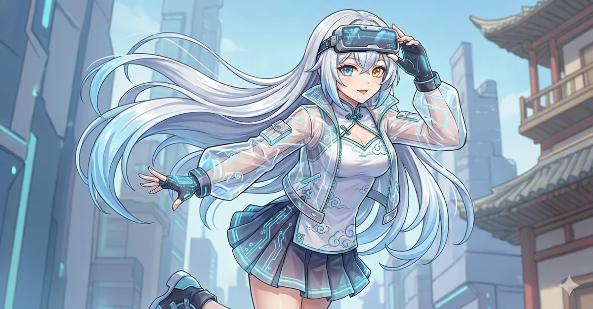

# 沐璃形象绘图与素材

本轮两张 PNG 已通过 bundled imagegen CLI 实际生成，模型为
`gpt-image-2.5-sunburst`。原角色参考取自仓库的无字原图；空态插画同时参考
本次生成的头像，保持角色、双眼位置、服饰与画风一致。网页已改用生成素材，旧 SVG 可保留供历史参考。



## 网页资产

| 用途 | 入包文件 | 尺寸 | 字节数 |
| --- | --- | --- | --- |
| 品牌、登录与助手消息头像 | `web/assets/muli-avatar.webp` | 256×256 | 21,388 |
| 空白欢迎页 | `web/assets/muli-empty.webp` | 900×600 | 86,380 |
| 浏览器图标 | `web/assets/muli-icon.png` | 64×64 | 8,452 |

三份轻资产合计 116,220 字节。正式页和纯前端预览共用，欢迎图的 HTML 固有显示尺寸为
380×253。原欢迎插画位置、青瓷蓝布局及无预设提示按钮的空态保持。

原始输出分别为 `output/imagegen/muli-avatar-sunburst-v1.png` 和
`output/imagegen/muli-empty-sunburst-v1.png`，只需在本地保留，不作为网页加载源。
头像请求尺寸为 1024×1024，但提供方实际返回 1254×1254；空态实际返回
1536×1024，与请求一致。不能把请求参数当成实际返回尺寸。

Pillow 后处理只调整透明边缘、缩放和留白，不重画人物：alpha 在 64 及以下归零，
64 至 240 之间线性映射到 0 至 255，240 及以上归为 255，以去掉低透明晕。
头像等比缩至 230×230，居中放入 256×256 透明底，四周各留 13 像素。
已检查浅青瓷与深夜青背景的实际合成，人物完整、低透明蓝白晕已消除；
网页接线后 3 份前端测试文件的 25 项回归全部通过（守卫 868ms、52.5MiB、swap 0）。
Chrome 6 的深浅主题实际截图均无晕或溢出：头像天然尺寸 256×256、实际显示 36×36，
欢迎图天然尺寸 900×600、当前视口实际显示 350×233.33；PNG favicon 已加载，欢迎区无预设按钮。
这些前端验证不等于构件安装或正式发行验收，不借用此前占位素材的验证结果。

## 实际 CLI 方式

本轮使用 bundled `imagegen/scripts/image_gen.py` 的 `edit` 子命令。
它接收参考图片，不调用 MuLi 的对话模型。以下记录实际脚本实参；
`IMAGEGEN_SCRIPT` 指向当前安装的 bundled 脚本，工作目录为仓库根目录。

```sh
python "$IMAGEGEN_SCRIPT" edit \
  --model gpt-image-2.5-sunburst \
  --quality medium --background transparent --output-format png \
  --image web/assets/standby.webp \
  --prompt-file tmp/imagegen/avatar-sunburst-prompt.txt \
  --size 1024x1024 \
  --out output/imagegen/muli-avatar-sunburst-v1.png

python "$IMAGEGEN_SCRIPT" edit \
  --model gpt-image-2.5-sunburst \
  --quality medium --background transparent --output-format png \
  --image web/assets/standby.webp \
  --image output/imagegen/muli-avatar-sunburst-v1.png \
  --prompt-file tmp/imagegen/empty-sunburst-prompt.txt \
  --size 1536x1024 \
  --out output/imagegen/muli-empty-sunburst-v1.png
```

调用使用用户提供、以 `/v1` 结尾的 OpenAI 兼容服务地址；密钥只通过临时环境传入，
未写入仓库或本页。本轮取消代理环境后直连；此处不保存密钥或实际服务地址。
下面完整保留两份最终 prompt，可重新保存为上面的 `--prompt-file` 输入；
无需依赖开发临时目录长期存在。

## 头像完整最终 prompt

```text
Use case: stylized-concept
Asset type: MuLi personal digital assistant app avatar, readable at 32 pixels
Input image: identity and palette reference only. Create a new illustration, do not copy its background or pose.
请以参考图中的沐璃为同一角色，绘制一张专业动画角色设计品质的精致日系Q版头肩头像。十八岁少女形象的本地数字生命与私人助手：银白长发，人物右眼为清澈蓝色、人物左眼为柔和淡金色，简洁青蓝发饰，温柔聪慧可靠，微微侧头，带一点自然笑意。青瓷蓝和月白的端正中式未来服装，只保留少量云纹、淡金与精巧电子发饰。干净流畅的线稿、柔和而清楚的赛璐璐上色，清晰漂亮的面部结构和发丝层次。头肩占画布约80%，紧凑轮廓，四周留圆形裁切安全空间。色彩为青瓷蓝#79AFC2、雾蓝#BFD8E3、月白#EFF7F7、深蓝灰#405B70、淡金#BEAA7B。
真正透明的PNG背景，透明区域干净，没有白底或棋盘格。人物完整，不裁头发顶部。不要文字、字母、标志、水印、边框、圆形底盘、背景场景、城市、光圈、复杂几何块、持物或多余人物。不要女友式、性感或幼儿形象。目标是温暖自然且精致耐看的助手图标。
```

## 空态插画完整最终 prompt

```text
Use case: stylized-concept
Asset type: MuLi chat welcome illustration, a transparent character cutout
Input image 1 is identity/clothing/palette reference only; image 2 is the selected face/style reference. Create a brand new composition with the same character.
使用两张参考图中的同一位沐璃，绘制一张适合简洁聊天页面的精致日系二次元Q版全身人物插画。必须是三头身左右的可爱Q版比例，头大身体小，但神态成熟温柔，十八岁少女形象的数字生命与可靠的本地私人助手。银白长发、蓝金异瞳、青蓝发饰，青瓷蓝和月白的中式未来感服装，少量淡金云纹和精致电子配饰。蓝色与金色双眼的左右位置、发饰和衣服细节与第二张头像一致。
沐璃侧坐在很少量的淡蓝云气之上，双腿自然收拢，手中打开一本精巧数字手札，微微抬头看向使用者，带自然笑意，像准备和人一起整理想法。手指和书本清楚自然。全身包括长发、鞋子与头顶完整入画，人物与少量云气占画布约65%，四周至少留12%干净透明余白。人物中间略偏下，上方有呼吸空间。专业动画角色设计、干净细腻线稿、柔和赛璐璐上色，精致的头发层次，脸部漂亮而清楚。采用青瓷蓝#79AFC2、雾蓝#BFD8E3、月白#EFF7F7、深蓝灰#405B70、少量淡金#BEAA7B。
3:2横向画布。真正透明PNG，透明区域干净，边缘没有白底、颗粒、杂点、棋盘格或光晕。只画人物、手札和极少淡蓝云气，不画场景、家具、圆形底盘、卡片、边框、UI、屏幕、文字、标语、字母、标志或水印。不可裁切人物，不要女友式、性感或幼儿形象。它应像专业画师绘制的完整Q版角色立绘，而不是贴纸拼图或产品说明图。
```
