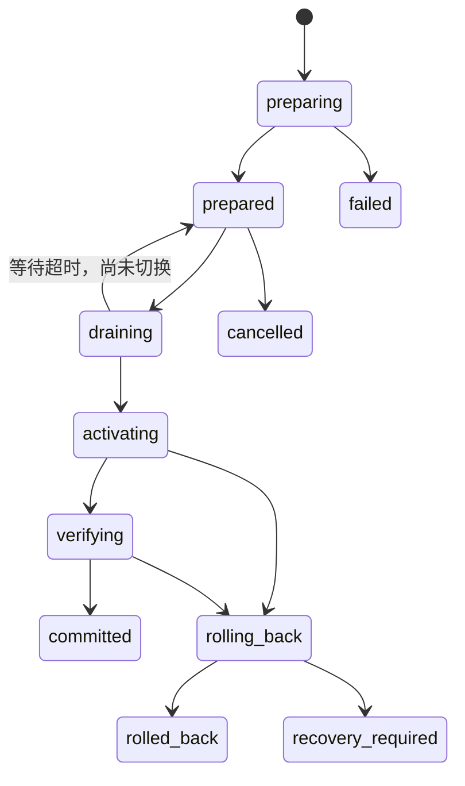

# 可恢复的自身配置、重启与更新

状态：2026-10-21 跨进程恢复整体设计；Linux 同版本的 journal、维护门、被动 Runtime、nonce 握手、Linux backend／受限 helper 及 CLI／管理提交、bootstrap 和终态投影已接入 2.19 候选，见[恢复入口](linux-recovery-operations.md)和[分块证据](restart-transaction-v2.15-design.md)。跨版本 A/B 切换仍未交付，也没有实测中断时长或恢复成功率。2.13 的恢复事实与 2.14 的进程内配置关闭失败恢复不等同于本稿的跨进程事务。本文落实[持续扩展要求](continuity-extensions-plan.md)。

## 交付目标与最小范围

管理操作先准备、再交接、再启动并确认健康；新版本或新配置不能使用时，自动恢复上一组可启动的程序与兼容配置。保留同一资料库、主会话和待办账本；已接受的新输入不因版本切换重新成为另一条主人请求。准备阶段旧服务继续工作，停止窗口只包含必要的排空、启动和确认。

第一片只实现**同一程序版本的配置与重启事务**：持久阶段记录、独立控制者、健康确认、恢复原配置与服务入口。第二片再增加隔离候选安装，且只自动切换到已经证明持久格式双向兼容的版本。第一片不以下载器或完整数据库迁移框架为前提；旧安装仍可聊天，能力不足时只拒绝该管理操作。

这里的恢复不是外部副作用撤销。已发送但未确认的消息、工具执行到一半、插件产生的外部操作仍可能结果未知；恢复旧程序不能把它们变成未执行，也不能自动重做。审批 future、网络连接与模型生成栈不跨进程复活；尽量缩短中断不等于恰好一次执行。

## 设计起点及可复用部分

下表保留改造前的基线与当时缺口；同版本入口当前进度以[恢复操作](linux-recovery-operations.md)为准。原位更新与跨版本格式证据仍是后续工作。

| 位置 | 已有行为 | 本方案需要补齐 |
| --- | --- | --- |
| `management.py:stage/_run/_apply` | 配置校验、私有快照、base/target 指纹、空闲后持锁应用 | applying/completed 无法区分准备、重启已接受与新进程健康；进程死亡后缺少完整接管协议 |
| `server.py:apply_configuration` | 原子保存，关闭或重建异常均恢复前一配置；观察者取消等待事务结束 | 进程硬退出仍不能靠进程内恢复；还需持久恢复意图与独立控制者 |
| `updates.py:apply` | 检查 uv tool 安装，调用原位 upgrade，不下载 Python，有限日志/时间 | 会修改当前解释器环境，没有独立候选和上一可用版本；源码 pull 与程序成功状态相互独立 |
| `service.py:action` | 当前用户服务、私有服务文件；Linux no-block，Windows 独立重启任务 | 返回 accepted 不能当健康完成；独立控制者须负责停止后的验证与回退 |
| `platforms/restart_service.py` | Windows 助手独立停止/启动主任务并删除自己 | 还没有候选选择、健康证明和恢复旧入口 |
| `platforms/service_runner.py`、`process.py` | 有限日志；子进程超时、取消和 POSIX 进程组回收 | 复用，不为管理操作再造通用进程库；Windows 后代回收仍须单独证明 |
| `Store.__init__` | 建表/索引及旧消息序号迁移，SQLite WAL | 构造 Store 不是无副作用预检；现有标记不足以证明程序降级兼容 |

现有管理、服务测试使用临时目录与命令替身，证明排队、指纹、脱敏、命令组织和错误报告；它们不证明真实服务更新成功或可恢复。特别是 `test_update_retains_uv_tool_requirements...` 断言原位 upgrade 命令，不是候选目录保留安装要求的验收。

## 一个控制者、一份恢复意图

继续使用现有 management 对象作为可见管理记录；增加位于 `data_dir/management` 的私有小型事务目录。每个事务保存 action、phase、generation、base/target 指纹、原始与候选解释器定位、安装 profile 摘要、原服务描述摘要、配置快照定位、启动 nonce、截止时间、健康证据及结果代码。密钥和带凭据 URL 留在 0600 文件，公开事件只给 ID、阶段和脱敏原因。

**独立恢复文件是跨进程接管的依据，SQLite management 行是其可重放显示副本**，不尝试将文件替换与 SQLite 假装成同一个事务。先原子落盘恢复意图，再做改变，再写结果；对外完成事件只能在对应文件阶段持久后发布。每次写入采用同目录临时文件、flush/fsync、原子替换；平台支持时同步父目录。文件不完整或版本不识别时拒绝切换，保留原服务。

一个安装范围同时只有一个管理事务，使用跨进程锁加 generation 比较，不靠查询最近 100 条管理记录发现重复。控制者可通过启动时/显式恢复入口重新进入；持有锁的旧进程退出后才允许接管，不以 PID 数字单独证明所有权。损坏记录不能静默重建为“成功”。不新增常驻轮询守护进程。

| 阶段 | 可确认的事实与重入规则 |
| --- | --- |
| preparing / prepared | 原环境未改；重复准备使用同事务候选定位，不能重复安装到当前目录；失败只清理本事务拥有的候选 |
| draining | 等待前台、团队、workflow、发送和收尾全部自然空闲，waiting 时仍可开始新工作；只有同一步确认 drained 后才关闭执行准入，保留持久 ingress；耗尽期限仍未空闲则保留旧服务，不强制取消用户工作 |
| activating | 切换意图已持久；独立控制者确认旧实例真正退出后，发布配置/解释器选择并启动目标；重复进入先核对实际状态，不能盲发第二次重启 |
| verifying | 目标进程已启动，尚未允许模型/工具/主动外发；只有对应 nonce、版本、配置和资料库的健康证明能提交 |
| committed | 目标成为当前可用代；持久提交后解除执行门；一次性标记交接完成并报告原始发起会话 |
| rolling_back / rolled_back | 停止候选，恢复上一兼容程序/配置并再次确认健康；rolled_back 表示恢复成功，原管理请求仍失败 |
| recovery_required | 无法确认旧进程已退出、外部修改配置、恢复文件损坏、旧环境失效等；保留证据，不报告回退成功、不循环重启 |

取消只在改变服务之前直接生效；进入 activating 后，调用者取消是停止观察，控制者仍须完成确认或回退。继续复用现有强拥有 cleanup/shield 思路，不能因网页断开把半完成切换遗留为 completed。

## 独立控制者与稳定入口

控制者必须存活于主服务停止之后。Linux 采用独立 transient user **service**，不在 `muli.service` 的 cgroup 内启动普通后台子进程；控制者和准备子进程各有硬期限与回收责任。`systemd-run --user` 建立的 service 由用户 manager 管理；进程 exec 成功仍不等于应用健康，见 [systemd-run 官方说明](https://www.freedesktop.org/software/systemd/man/latest/systemd-run.html)。

Windows 复用独立任务机制，扩展为读取同一事务协议、核对主任务已停止、启动/确认/回退；macOS 需要独立的一次性 launchd job。首片可先交付已验证的 Linux 后端；其它平台未实现对应控制者时 capability 明确 transaction_unsupported，继续提供原服务能力，不能悄悄执行原位更新。测试替身通过不表示真实平台已经验收。

第一片保留原解释器和原服务描述，重启无需部署路径重排。第二片增加小型稳定启动入口，读取当前已确认的解释器选择，再用绝对路径执行 MuLi；它不导入候选的管理实现来决定是否回退。入口代码/协议也要版本化，上一可用控制者及其 Python 基础解释器在事务结束前不得被替换或清理。

uv 生成的命令链接仍属于 uv，不能手工改写它们的 receipt 或复制环境来冒充 uv 已安装新版本。为避免“服务已升级、CLI 仍运行旧应用”，支持托管更新的首个发行版，其 CLI 在解析 config/data 定位后须委托给已确认的活动解释器，并防止递归委托；服务使用同一选择文件。原 uv tool 环境作为稳定入口保留。若这个入口尚未交付，第二片只能报告 service_only 能力，不能宣传整个安装都已升级。用户在外部重新安装 uv tool 后，指纹变化使旧候选失效，重新核对安装来源。

## uv 候选准备：继承要求，不碰当前环境

通过 Context7 查阅 uv 实现及官方 CLI：`uv tool upgrade` 会读原 receipt 并复用安装约束/设置；全新 `uv tool install` 不会自动继承另一个目录中的 receipt。因此不能只把当前 upgrade 命令换成一个新目录的裸 install。参考 [工具升级](https://docs.astral.sh/uv/concepts/tools/#upgrading-tools)及 [uv receipt/upgrade 实现](https://github.com/astral-sh/uv/blob/main/crates/uv-tool-commands/src/upgrade.rs)。

准备步骤：

1. 识别当前安装和 uv 版本，核对实际 `sys.prefix`、工具目录、工具名、解释器、receipt 与服务使用的解释器。开发环境、editable/VCS/本地可变来源及不识别的 receipt 格式先明确 unsupported，不改它们。路径由安装发现及配置产生，不能假设都位于 `~/.local/share`。
2. 读取有大小上限的 `uv-receipt.toml`，连同有效用户配置/必要索引凭据生成规范化 install profile：主人原始主 requirement、extras、额外 requirements、constraints、overrides、构建限制、索引及顺序/策略、find-links、Python 选择和影响解析的设置。凭据不进入公开摘要。格式适配只支持已验证的 uv 版本；未知影响依赖语义的选项不静默丢弃。
3. 目标正式版本必须满足主人原有约束；保留 `mcp/channels` 等 extras 与额外依赖。候选解析失败就是 prepare_failed，不靠卸掉扩展或放松约束通过。有效 profile 来自 receipt 与配置的验证合并，不依赖管理进程碰巧继承的环境。
4. 为本事务分配**最终保留路径**作为 `UV_TOOL_DIR`，并将 `UV_TOOL_BIN_DIR`、cache/temp 指到本事务拥有的目录。在那里使用 argv 形式的 `uv tool install`，显式给现有基础 Python、`--no-python-downloads`、完整包 extras 与精确目标版本、相应 `--with`/约束/覆盖/索引设置。当前工具目录和公共 bin 不可作为输出目的地。本文没有执行这些命令；对应选项见 [CLI](https://docs.astral.sh/uv/reference/cli/#uv-tool-install)及 [目录环境变量](https://docs.astral.sh/uv/reference/environment/#uv_tool_dir)。
5. 不在缓存目录做 `uvx` 候选，不移动/重命名完成后的虚拟环境；虚拟环境通常带绝对解释器路径，见 [Python venv 可移植性说明](https://docs.python.org/3/library/venv.html#how-venvs-work)。源构建默认禁用，缺可用 wheel 则失败；不在这一步下载 Python、模型或通用构建工具链。
6. 读取候选包元数据、实际依赖/扩展和新 receipt，验证与 profile 一致，记录候选路径、版本和摘要。隔离预检使用临时配置/临时库，不加载真实插件，不连 MCP/渠道/模型，不构造指向真实资料库的 Runtime。

`UV_TOOL_DIR` 与 `UV_TOOL_BIN_DIR` 只改变候选安装落点，不提供资源沙箱。保留索引身份/认证来源，同时沿用当前禁止代理环境的产品约定；只给候选明确需要的凭据、证书和受控 uv 设置，移除会改变解析的无关 `UV_*`、`PYTHONPATH` 与虚拟环境覆盖。不要清空 `HOME` 等系统变量，也不要把所有环境原样转发。

**区分原安装意图与部署锁定**：候选为可复现部署而使用 `==目标版本`，不能将这个新 receipt 的精确 pin 当成主人原始约束，导致下一次更新永远冲突。规范化 profile 独立保存原约束，后续更新先检测外部安装变更，再以该原始意图验证新目标。不能通过直接编辑 uv receipt 去消除 pin。

准备还应记录实际取得的构件来源/摘要；“PyPI 版本号更大”不等于已经校验整套候选。不要在程序准备成功路径里顺带 pull 用户源码参考；保留原有本地修改，源码参考更新作为独立可观察结果。

## 资源、磁盘与保留预算

下表是建议的首期配置默认值，需 strict 类型和明确上界校验；不是当前代码已具备的保护，也不在失败后自动放宽。生产管理限制与开发 `check_local.py` 的职责分开。

| 对象 | 建议预算 | 失效行为 |
| --- | --- | --- |
| 单次 prepare / preflight | 180 秒 / 30 秒；准备进程树内存 512 MiB、swap 0、Tasks 64、CPU 单核等效上限 | 父子进程全部终止并确认回收；当前服务继续 |
| 当前服务与准备/控制者 | 同一应用父 slice 合计 1 GiB、swap 0、Tasks 128；保持服务自身较小子限额 | 核验父子 cgroup 关系，不能把两个 sibling 各自上限称为合计；核验失败拒绝 prepare |
| 排空 / 新实例确认 / 旧实例确认 | 30 秒 / 30 秒 / 30 秒；控制者总期限覆盖完整失败回退和清理宽限 | 排空超时回 prepared；确认失败进入一次回退，不无限重启 |
| 私有恢复记录与命令日志 | 每事务配置/profile 各 256 KiB；结构化公开记录 16 KiB；日志沿用有限轮转 | 超限明确失败，不能截掉指纹/ID后继续切换 |
| 槽位 | 当前、上一已确认、一个候选；候选环境建议 512 MiB，私有 cache/temp 共 256 MiB | 不为腾位删除当前、唯一上一可用或用户原 uv 环境 |
| 可用磁盘 | prepare 前预留候选+cache预算及至少 256 MiB 安全余量；遍历条数/时间也有界 | 空间不足或遍历无法完成拒绝准备，不全盘扫描/清缓存 |

CPU/内存/任务限制用已存在的系统服务资源能力执行；开发验证仍必须经过 `/data0/MuLi/scripts/check_local.py`，单次 1 GiB、共享 2 GiB，禁止裸跑。受限生产 prepare 后端不存在时保持原服务，不退回无保护安装。

uv 没有这里所需的通用安装目录硬配额开关。磁盘预留、有限扫描与超限停止只是停止阈值，存在写入超调，不能宣称硬磁盘上界；要求硬配额的安装必须已具备可核验的文件系统配额，否则拒绝该严格模式。不为这项功能自动创建分区、提权配置 quota 或发明另一套依赖下载器。临时文件放在同一计费目录，不能让默认 `/tmp` 或全局 cache 绕过统计。

旧环境的实际尺寸若已超建议预算，不停用现有服务；只报告需要的额外空间/不支持的自动准备。cleanup 只删除 manifest 已登记且不再被选择的本事务文件；版本回退证据与上一可用环境在确认新代健康前保留，不能依靠“网络上以后还能下载旧包”。

## 排空、启动确认与配置恢复

准备过程中不持有 configuration_lock 等待下载。到切换边界重新校验 base 配置、服务描述、程序与安装 profile 指纹；候选准备期间手动修改使旧候选 stale。draining 先等待全部 owner 自然空闲；确认 drained 时，在既有配置锁内同一步原子关闭执行准入门：HTTP、渠道、team、workflow、reminder 和 attention 都必须遵守；只改 `busy` 查询不够。

已经接受的入站事件先持久确认；drained 关门后不启动新模型/工具。不能可靠持久接收的渠道，暂停上游 ACK 而不是假成功。排空包括 driver 最终通知、工具清理、团队报告交接、已有 sending 出站和管理发起调用本身的工具结果落盘。pending ingress 可以保留等待新实例；waiting 期间持续新输入可能使服务无法自然空闲，只能有限等待，不能提前关门卡住已有工作的子任务。排空到期不自动杀用户任务；保留 prepared 并恢复原服务准入，下次明确安全边界再继续。

独立控制者确认旧服务已停止且没有残留 writer，才发布目标配置与解释器选择。配置替换和选择文件不能原子跨文件提交，因此 activation intent 记录旧/新摘要与每一步实际结果；控制者死亡后按摘要和 nonce 重新核对，确定完成或恢复，不能凭“处于 activating”盲目重复操作。Stop/Start 请求 accepted、端口被占用、收到任意 200 都不是证明。

新增有界、受本机认证保护的 readiness 结果，或等价的私有 IPC 证明，包含 transaction/generation、boot nonce、实际版本/解释器摘要、实际绑定地址、配置指纹、Store instance/persistence 版本、主会话 ID、恢复处理完成及本地核心组件状态。当前 `/api/status` 还会探测电脑和多项集成，不直接拿其任意成功响应作为健康证明。

候选以 probation 启动：可完成本地配置/数据库兼容检查和恢复，但在 committed 前不得自动唤醒 pending、发送渠道消息、运行模型、启动外部 MCP/插件副作用或触发 onboarding。同版本入口已将这些动作分成被动准备与提交后激活；跨版本候选还须在 Store 构造前证明持久格式兼容，不能只复用一个 HTTP 检查。健康证明只承诺已验证的本地核心能力；外部服务和任意插件真实工作能力另列未验证，不以模型请求作为更新探针。

确认后先持久 committed，再解除准入门；候选若在这两步之间死亡，下次启动继续同一个已提交代并重新确认本地就绪，不能误当未提交而还原数据库。提交后组件激活失败记录 degraded/activation_failed，允许程序回退但不承诺撤销已经发生的外部动作。成功报告回到原发起会话，同一 transaction 只交付一次意图，发送确认未知仍沿用既有 outbox 语义。

恢复配置必须比较当前文件与本事务 target 指纹：只有仍是本事务所写目标时才能恢复旧快照；用户期间手工修改、路径被替换或内容损坏则 recovery_required，不覆盖新设置。恢复旧文件成功仍需旧运行时/服务健康；不能仅凭文件指纹相同就把管理操作记 completed。

## 数据兼容与回退边界

首期自动更新要求旧/新程序对**同一持久格式**兼容：不仅 SQLite 表结构，还包含 objects/ingress/outbox 的 JSON 语义、配置 schema、receipt/profile 语义与管理交接协议。候选发行包须提供无需启动应用即可读取的兼容 manifest：协议版本、可读/可写持久格式、配置格式、是否需要迁移；版本号大小不能替代该证据。

下一开发片已实现[兼容元数据纯判定](upgrade-compatibility.md)，独立区分 database、objects、configuration、ingress、outbox、memory、install_profile 七个完整语义领域。它只比较经调用者提供的声明，不读取真实库、不发当前版本格式标记，也不授权切换。缺少来源证明、原版本 manifest 或真实格式证据时仍拒绝；现有 protocol 1 的单安装身份不因声明中的协议数字相同而变成 A/B 协议。

[安装意图解析](install-profile-design.md)已实现固定 receipt 格式的纯入口，[安装内 receipt 观察](install-receipt.md)将它接到已核 manifest 的固定 prefix 来源并支持变动重验；uv 身份、完整解析上下文与候选安装仍未实现。[无迁移启动方案](no-migration-startup-design.md)已列出 Store、Memory 与 ChannelManager 的实际隐式写入路径，需全部纳入候选准入，不能只禁止其中一个构造器。

[格式证据读取器](format-evidence.md)已独立实现：宿主提供专用连接，读取器在单一快照中核对完整格式标记、资料库及主人主会话身份，读取预算有限且不补数据。它不认证连接路径、发行来源或格式语义，也未接启动；缺少完整标记的历史库仍拒绝，不能自动补出兼容证明。

在启动候选 Store 之前，旧控制者以只读方式检查当前版本标记与候选 manifest；缺失、未知、需要破坏性迁移或旧程序不能读取候选写入格式时，拒绝自动切换并保留原服务。现有 2.12 没有完整兼容 manifest，因此不能仅凭本文宣称可安全跨任意历史版本自动降级。候选还须有拒绝隐式迁移的启动模式；不能先让 `Store.__init__` 修改真实库，再检查是否兼容。

可兼容回退仅选择旧程序和旧配置，**继续使用包含最新事实的当前数据库**。管理失败不自动恢复旧数据库备份，不删除新收件/发送确认/unknown 记录。程序降级可以成功而外部操作仍未知，两种结果分别报告。

将来需要迁移时再交付单独的维护协议：停止所有 writer、一致性备份及恢复演练、空间预算、验证迁移后的数据/旧程序读取能力，并定义切换后新增事实的处理。在 WAL 模式下不能拿运行中的单个 `.sqlite3` 文件复制当一致性备份；SQLite 提供 [Backup API](https://sqlite.org/backup.html)。恢复旧备份会丢掉之后的真实收件、审批、结果与发送确认，可能诱发重复副作用，必须单独有恢复证据；不是 A/B 程序选择的自动分支。

## agent 短中断续接

沿用原 main_session、ingress 幂等键、commitment/任务说明、team report intent、compaction revision 与原消息证据。不用模型生成一份摘要替代这些事实，也不因重启提交一条新的主人任务。新实例先完成恢复事实 A，再显示旧运行已中断、旧审批失效与可验证的工具结论。

计划重启首期等待安全边界，不保存 Python 调用栈或未结束的模型流。已持久 pending 输入按原规则继续；已启动的工具/发送在崩溃后按原账本保留 known/not_executed/unknown，不自动重做。当前 channel manager 将 sending 恢复为 unknown，显式 allow_unknown 才能重试；管理恢复不能绕过它。未保存的模型 token 无法由程序回退找回，不能伪称完整恢复。

管理交接事件只提供受信宿主状态资料，不能变成新的用户授权。原有 `self_update` 的真实审批要求继续有效；用户已授权本次实现不代表运行中的 MuLi 可以跳过未来的产品审批。管理事务本身在获得既有授权后自动确认/回退，不增加一次“现在可以恢复吗”的批准门。

## 失败含义与验证顺序

| 结果 | 含义 |
| --- | --- |
| prepare_failed / stale / unsupported | 未切换；旧服务继续，不报告需要恢复真实数据 |
| rolled_back | 候选请求失败；上一程序与兼容配置已重新健康，数据库事实未倒退 |
| recovery_required | 无法证明恢复成功；停止盲目切换，保留具体阶段和证据 |
| committed + degraded | 本地提交成功但某项外部/可选能力不可用；不谎报端到端健康 |
| unknown tool/delivery | 原外部动作缺确认，与管理成功/失败分别呈现；没有自动重试按钮 |

先交付配置/重启事务及恢复事件 A，再交付支持的 uv profile 候选与兼容版本切换；不同时实现通用安装器、数据库降级迁移、跨平台磁盘配额或 checkpoint 任意 agent 栈。同步更新 `self-management.md`、`operations.md`、服务说明与发行边界；旧管理 API 的 accepted 与最终结果要清楚区分。

必要测试全部在临时目录/临时 SQLite、假 uv/服务/时钟下，经统一 guard 执行：每个阶段进程中断后的接管；重复/并发管理请求；观察者双取消；配置手工修改；后台新输入不丢不重复；旧 driver 收尾；旧实例残留；伪造/迟到 nonce；启动 accepted 但不健康；回退也失败；extras/with/constraints/多索引与凭据保留；候选精确 pin 不冻结未来升级；超时/OOM 后代回收；预算不足不删旧环境；不兼容格式在真实库写入前拒绝；回退保留新 ingress/outbox/unknown。

再以有限假服务子进程证明控制者在主进程退出后仍完成恢复，最后才分平台记录真实服务证据。当前设计阶段不执行安装、下载、重启、真实外部账号或真实模型；未取得对应证据前，不宣称真实跨平台 A/B 更新已实现。

下一开发分支已补[真实进程退出接管回归](management-process-recovery.md)：真实 journal/writer 锁与临时 WAL 验证已提交事实保留，以及缺少宿主健康证据时停在 recovery_required。另一用例通过独立宿主与两个控制者覆盖成功激活后的控制者死亡窗口，真实 nonce HTTP 重观察后只记一次终态；未覆盖真实系统服务或 SQLite 投影提交中途被杀。
